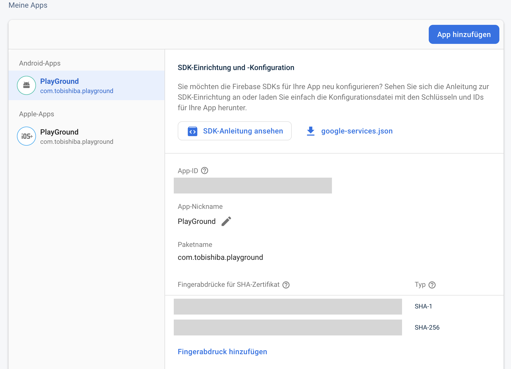

# Auth

You can use [Firebase Authentication](https://firebase.google.com/docs/auth) to allow users to sign in to your app using one or more sign-in methods, including email address and password sign-in, and federated identity providers such as Google Sign-in and Facebook Login.

## Installation
### Nuget
[](https://www.nuget.org/packages/Plugin.Firebase.Auth/)

> Install-Package Plugin.Firebase.Auth

## Setup

- Follow the instructions for the [basic setup](https://github.com/TobiasBuchholz/Plugin.Firebase/blob/master/README.md#basic-setup)
- Enable Authentication at your project in the [Firebase Console](https://console.firebase.google.com/).
- When using [Plugin.Firebase.Auth.Google](https://www.nuget.org/packages/Plugin.Firebase.Auth.Google/), add the following lines of code after calling `CrossFirebase.Initialize()`:
```c#
#if IOS
  FirebaseAuthGoogleImplementation.Initialize();
#elif ANDROID
  FirebaseAuthGoogleImplementation.Initialize("your-google-request-id-token");
#endif
```
- The `googleRequestIdToken` can be accessed at the [Google API Console](https://console.developers.google.com/apis/credentials) (make sure to use the Client-ID of the Web client)

### iOS specifics
- Enable keychain entitlement in Entitlements.plist:

```xml
  <dict>
    <key>keychain-access-groups</key>
    <array>
      <string>$(AppIdentifierPrefix)my.fancy.app</string>
    </array>
  </dict>
```
- In case you are using Authentication via Google, add an url scheme to your apps `Info.plist`:
```xml
  <key>CFBundleURLTypes</key>
  <array>
    <dict>
      <key>CFBundleURLSchemes</key>
      <array>
        <string>com.googleusercontent.apps.123456-abcdef</string>
      </array>
    </dict>
  </array>
```
- For more specific instructions take a look at the official [Firebase documentation](https://firebase.google.com/docs/auth/ios/start?hl=en)

### Android specifics

- Make sure you have added the SHA-1 fingerprint matching the keystore you've used for signing the app bundle to the android project settings in the firebase console: 


- Call `FirebaseAuthImplementation.HandleActivityResultAsync(requestCode, resultCode, data);` from `MainActivity.OnActivityResult(...)`
- If you are on version 2.0.5 or later, add the following package to your project's `.csproj` file to prevent build errors:
```xml
  <PackageReference Include="Xamarin.AndroidX.Browser" Version="1.6.0.2" />
```

For more specific instructions take a look at the official [Firebase documentation](https://firebase.google.com/docs/auth/android/start?hl=en)

## Usage

Take a look at the [documentation](https://github.com/AdamEssenmacher/GoogleApisForiOSComponents/blob/master/docs/Firebase/Auth/GettingStarted.md) for the AdamE.Firebase.iOS.Auth packages, because Plugin.Firebase's code is abstracted but still very similar.

Since code should be documenting itself you can also take a look at the following classes:
- [src/.../IFirebaseAuth.cs](https://github.com/TobiasBuchholz/Plugin.Firebase/blob/master/src/Shared/Auth/IFirebaseAuth.cs)
- [src/.../IFirebaseUser.cs](https://github.com/TobiasBuchholz/Plugin.Firebase/blob/master/src/Shared/Auth/IFirebaseUser.cs)
- [tests/.../AuthFixture.cs](https://github.com/TobiasBuchholz/Plugin.Firebase/blob/master/tests/Plugin.Firebase.IntegrationTests/Auth/AuthFixture.cs)
- [sample/.../AuthService.cs](https://github.com/TobiasBuchholz/Plugin.Firebase/blob/master/sample/Playground/Common/Services/Auth/AuthService.cs)

### Native provider credentials

Provider SDKs create native Firebase credentials in platform-specific code. After you create a native `Firebase.Auth.AuthCredential`, pass it through the cross-platform Auth entry point to keep exception handling and user conversion consistent:

```csharp
using Plugin.Firebase.Auth;

#if ANDROID
var credential = Firebase.Auth.EmailAuthProvider.GetCredential(email, password);
#elif IOS
var credential = Firebase.Auth.EmailAuthProvider.GetCredentialFromPassword(email, password);
#endif

var user = await CrossFirebaseAuth.Current.SignInWithCredentialAsync(credential);
```

Use `LinkWithCredentialAsync(credential)` the same way when linking a provider credential to the current user.

### Updating profile data

Use `UserProfileChangeRequest.Builder` when updating profile fields. Fields omitted from the request remain unchanged, `null` clears a field, and `""` is passed through to Firebase as an explicit value.

```csharp
await CrossFirebaseAuth.Current.CurrentUser.UpdateProfileAsync(
    new UserProfileChangeRequest.Builder()
        .SetDisplayName("Bruce Wayne")
        .SetPhotoUrl(null)
        .Build()
);
```

The legacy `UpdateProfileAsync(string? displayName = "", string? photoUrl = "")` overload treats `""` as omitted and is obsolete.

## Language

Set `LanguageCode = "fr"` (or any BCP-47 code) before invoking an Auth flow that triggers user-facing content such as password-reset emails, email-verification emails, or phone-auth SMS.
Call `UseAppLanguage()` to reset to the app language.

## User reauthentication and reload

Call `CurrentUser.ReauthenticateWithEmailAndPasswordAsync(email, password)` before sensitive email/password user operations that require recent authentication.
Call `CurrentUser.ReloadAsync()` to refresh that user from the backend. This is the preferred thin-wrapper API because Firebase exposes reload on the user object.

For example, after sending an email-verification message, reload the user before reading `IsEmailVerified` again:

```csharp
var user = CrossFirebaseAuth.Current.CurrentUser;
if(user is not null) {
    await user.ReloadAsync();
    var isVerified = user.IsEmailVerified;
}
```

`ReloadCurrentUserAsync()` remains available for existing code, but is obsolete. New code should prefer `CurrentUser.ReloadAsync()` after checking `CurrentUser` is not `null`.

## Error handling

Native Firebase Auth failures are wrapped in `CrossPlatformFirebaseAuthException`. The wrapper preserves the original native exception in `InnerException` and exposes stable inspection fields for the native exception type, domain, code, and message.

`FirebaseAuthErrorClassifier.TryClassify(...)` is an optional, best-effort helper for common failures such as invalid credentials, missing users, user collisions, weak passwords, recent-login requirements, and throttling. Call it explicitly in your app code when you want a simple cross-platform branch. When classification returns `null`, fall back to `NativeExceptionTypeName`, `NativeErrorDomain`, `NativeErrorCode`, `NativeErrorMessage`, or `InnerException`.

```csharp
public async Task<string?> SignInAsync(string email, string password)
{
    try {
        await CrossFirebaseAuth.Current.SignInWithEmailAndPasswordAsync(email, password);
        return null;
    } catch(CrossPlatformFirebaseAuthException ex) {
        return FirebaseAuthErrorClassifier.TryClassify(ex) switch {
            FirebaseAuthFailure.InvalidCredentials => "Invalid email or password.",
            FirebaseAuthFailure.UserNotFound => "No account exists for that email address.",
            FirebaseAuthFailure.TooManyRequests => "Too many attempts. Try again later.",
            _ => ex.NativeErrorMessage
        };
    }
}
```

## Migration from v4

Before v5, Auth failures were typically handled by catching `FirebaseAuthException` and inspecting its normalized `Reason` value.

In v5:
- Catch `CrossPlatformFirebaseAuthException`.
- Call `FirebaseAuthErrorClassifier.TryClassify(ex)` only if you want a simple cross-platform classification.
- Inspect `NativeExceptionTypeName`, `NativeErrorDomain`, `NativeErrorCode`, `NativeErrorMessage`, or `InnerException` when you need precise native details.
- `SignOutAsync()` now follows the same unified exception model when the underlying native Auth SDK reports a failure.

## Next-release migration notes

`IAuthTokenResult.GetClaim<T>` now converts numeric claims to the requested type, with the same rules on both platforms:

- A numeric claim can be read as any numeric type (including `decimal`), an enum, or a nullable form of either. Previously Android threw `InvalidCastException` unless `T` was exactly the type the native SDK parsed the claim into, so `GetClaim<long>` failed for a small value. iOS returned `null` for `decimal`, so the call threw `NullReferenceException`.
- A value outside the range of `T` throws `OverflowException`. Previously iOS wrapped it: a claim of 300 read as `byte`, or as a `byte`-backed enum, became 44. Enums are range checked against their underlying type, not against their defined members.
- A fractional value read as an integral type or an enum truncates toward zero, so 2.7 becomes 2 and -2.7 becomes -2. The range check uses the value before truncation, so 2147483647.9 read as `int` or -0.5 read as `uint` throws `OverflowException`. NaN and infinity throw `OverflowException` when read as an integral type, an enum, or `decimal`. A value that would round to infinity when read as `float` throws `OverflowException`.
- Claims are not coerced between JSON types. A string or boolean claim read as a number, a numeric or boolean claim read as `string`, a numeric claim read as `bool`, and any claim read as `char` throw `InvalidCastException`. Android already threw in these cases. iOS used to return 1 or 0 for a boolean read as a number, whether a number was non-zero for a number read as `bool`, `null` for a number or boolean read as `string`, and a character made from the low byte of a number read as `char`.
- The elements of a requested list type, such as `GetClaim<List<long>>`, and the values of a requested dictionary type follow the same rules:
  - On iOS, a number in a list or dictionary requested with `string` elements used to become `null`, and with `bool` elements `true` or `false`. It now throws `InvalidCastException`. A number that doesn't fit a numeric element type throws `OverflowException` instead of wrapping.
  - On Android, numbers in a list or dictionary requested with a numeric element type now convert to it. Previously any element type other than the one the native SDK parsed the number into threw `ArgumentException`.
  - The exception was a dictionary inside a list, whose values went through `Convert.ChangeType`. That rounded fractions (2.7 read as `long` became 3) and coerced between types, for example `"123"` to 123 and `true` to 1.
  - A number in a list requested with `string` or `bool` elements, or in a dictionary requested with `bool` values, now throws `InvalidCastException`. Dictionary values requested as `string` are still converted with `ToString()`.

On iOS, read each claim as its JSON type and convert it in your own code if you relied on the old coercions.

## Release notes
- Next
  - Add email/password user reauthentication and user-level reload APIs.
  - Mark `ReloadCurrentUserAsync()` obsolete; use `CurrentUser.ReloadAsync()` after checking `CurrentUser` is not `null`.
  - `GetClaim<T>` converts numeric claims to any requested numeric or enum type on both platforms, truncates fractional values toward zero, throws `OverflowException` for out-of-range values, and throws `InvalidCastException` instead of coercing claims between JSON types (issues #709, #710).
- Version 5.0.1
  - Fix for wrong Core project version dependency at nuget.org
- Version 5.0.0
  - Replace the normalized `FirebaseAuthException` / `FIRAuthError` model with `CrossPlatformFirebaseAuthException`.
  - Preserve native Firebase Auth exceptions in `InnerException` and expose platform-specific metadata for inspection.
  - Add `FirebaseAuthErrorClassifier` for best-effort, non-exhaustive classification of common Auth failures.
  - Migrate by catching `CrossPlatformFirebaseAuthException`, optionally calling `FirebaseAuthErrorClassifier.TryClassify(ex)`, and using native metadata for precise handling.
- Version 4.0.1
  - Add `ReloadCurrentUserAsync()` to refresh the currently signed in user from the backend.
  - Add `LanguageCode` and `UseAppLanguage()` to control the language used for Auth-generated user-facing flows (reset/verification emails, SMS).
- Version 4.0.0
  - Upgrade baseline to **.NET 9+**.
  - Remove MAUI-specific dependencies (Auth remains usable from non-MAUI mobile .NET projects).
    - Android initialization now requires an `ActivityLocator` function (e.g. `() => Platform.CurrentActivity`).
  - Raise minimum platform versions (iOS 15+, Android 23+).
  - Raise minimum Firebase SDK versions (iOS 12.5+, Android BoM 33.0+).
  - Remove built-in Auth provider implementations (Facebook/Google/Apple); providers must be implemented directly via native SDKs per platform.
- Version 3.1.2
  - Fix NRE with Google Auth when cancelling sign in (#500)
- Version 3.1.1
  - Using AdamE.Firebase.iOS.* minimum version 11
- Version 3.1.0
  - Update to .net8
- Version 3.0.0
  - Swapped Xamarin.Firebase.iOS.Auth (native SDK 8.10.0) for AdamE.Firebase.iOS.Auth (native SDK 10.24.0)
- Version 2.0.7
  - Added AddAuthStateListener to FirebaseAuth (PR #246)
- Version 2.0.6
  - Fix dates in android AuthTokenResultWrapper (issue #244)
- Version 2.0.5
  - Bump up Xamarin.Firebase.Auth from 121.0.8 to 122.2.0 (issue #131)
- Version 2.0.4
  - Separating Auth.Google into its own package (PR #210)
- Version 2.0.3
  - Return `FirebaseUser` in `FirebaseAuthImplementation.CreateUserAsync(email, password)` method (issue #183)
- Version 2.0.2
  - Bump up Xamarin.Google.iOS.SignIn from 5.0.2.3 to 5.0.2.4 (issue #158)
- Version 2.0.1
  - Remove unnecessary UseMaui property from csproj files
  - Readd net6.0 tfm
