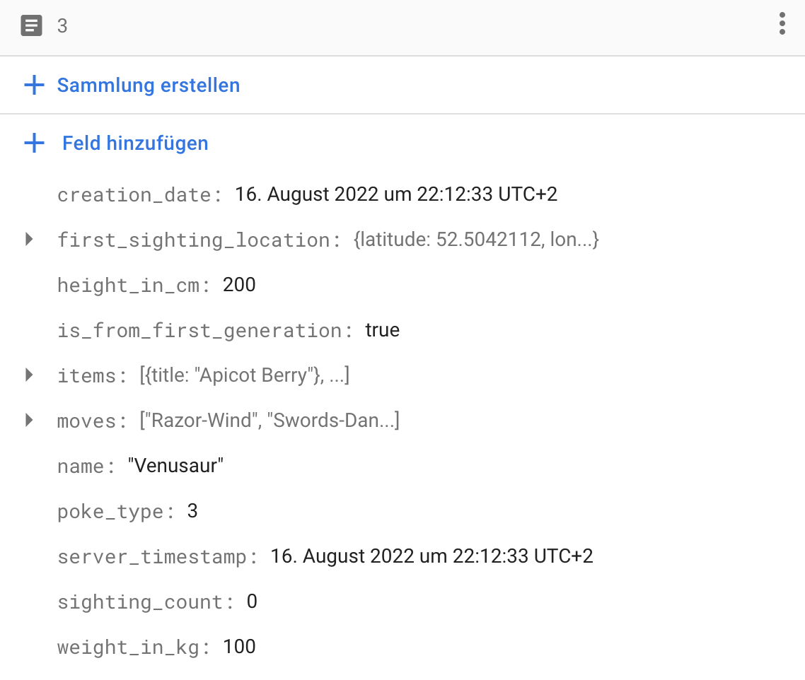

# Firestore

Cloud Firestore is a flexible, scalable database for mobile, web, and server development from Firebase and Google Cloud. Like Firebase Realtime Database, it keeps your data in sync across client apps through realtime listeners and offers offline support for mobile and web so you can build responsive apps that work regardless of network latency or Internet connectivity. Cloud Firestore also offers seamless integration with other Firebase and Google Cloud products, including Cloud Functions.

## Installation
### Nuget
[](https://www.nuget.org/packages/Plugin.Firebase.Firestore/)

> Install-Package Plugin.Firebase.Firestore

## Setup

- Follow the instructions for the [basic setup](https://github.com/TobiasBuchholz/Plugin.Firebase/blob/master/README.md#basic-setup)
- Enable Cloud Firestore at your project in the [Firebase Console](https://console.firebase.google.com/)

## Usage

To be able to fetch your data from Firestore, create a POCO that implements the `IFirestoreObject` interface and has a public parameterless constructor. Use the `FirestoreDocumentId` and `FirestoreProperty` attributes to hook up its properties. For example:

> Firestore's reflection-based model mapping is not currently compatible with full trimming or Native AOT.

```c#

public sealed class Pokemon : IFirestoreObject
{
    [FirestoreDocumentId]
    public string Id { get; private set; }

    [FirestoreProperty("name")]
    public string Name { get; private set; }

    [FirestoreProperty("weight_in_kg")]
    public double WeightInKg { get; private set; }

    [FirestoreProperty("height_in_cm")]
    public float HeightInCm { get; private set; }

    [FirestoreProperty("sighting_count")]
    public long SightingCount { get; private set; }

    [FirestoreProperty("is_from_first_generation")]
    public bool IsFromFirstGeneration { get; private set; }

    [FirestoreProperty("poke_type")]
    public PokeType PokeType { get; private set; }

    [FirestoreProperty("moves")]
    public IList<string> Moves { get; private set; }
    
    [FirestoreProperty("first_sighting_location")]
    public SightingLocation FirstSightingLocation { get; private set; }

    [FirestoreProperty("items")]
    public IList<SimpleItem> Items { get; private set; }

    [FirestoreProperty("creation_date")]
    public DateTimeOffset CreationDate { get; private set; }

    [FirestoreServerTimestamp("server_timestamp")]
    public DateTimeOffset ServerTimestamp { get; private set; }

    [FirestoreProperty("original_reference")]
    public IDocumentReference OriginalReference { get; private set; }

}
```

This class is represented in firestore like this:



Documents can also be read as raw dictionaries when the field set is not known at compile time:
```c#
var snapshot = await CrossFirebaseFirestore.Current
    .GetDocument("pokemons/1")
    .GetDocumentSnapshotAsync<Dictionary<string, object>>();

var data = snapshot.Data;
var name = data["name"] as string;
```

Firestore stores dates as instants. A `DateTimeOffset` always identifies one. A `DateTime` must have `DateTimeKind.Utc` or `DateTimeKind.Local` and is stored as its UTC instant; writing one with `DateTimeKind.Unspecified`, such as `default(DateTime)`, throws `ArgumentException`. Use `DateTime.SpecifyKind` to say which time zone such a value is in. Dates are read back in UTC.

### Further information

Take a look at the [documentation](https://github.com/AdamEssenmacher/GoogleApisForiOSComponents/blob/master/docs/Firebase/CloudFirestore/GettingStarted.md) for the AdamE.Firebase.iOS.CloudFirestore packages, because Plugin.Firebase's code is abstracted but still very similar.

Since code should be documenting itself you can also take a look at the following classes:
- [src/.../IFirebaseFirestore.cs](https://github.com/TobiasBuchholz/Plugin.Firebase/blob/master/src/Shared/Firestore/IFirebaseFirestore.cs)
- [src/.../ICollectionReference.cs](https://github.com/TobiasBuchholz/Plugin.Firebase/blob/master/src/Shared/Firestore/ICollectionReference.cs)
- [src/.../IDocumentReference.cs](https://github.com/TobiasBuchholz/Plugin.Firebase/blob/master/src/Shared/Firestore/IDocumentReference.cs)
- [src/.../IQuery.cs](https://github.com/TobiasBuchholz/Plugin.Firebase/blob/master/src/Shared/Firestore/IQuery.cs)
- [src/.../ITransaction.cs](https://github.com/TobiasBuchholz/Plugin.Firebase/blob/master/src/Shared/Firestore/ITransaction.cs)
- [src/.../IWriteBatch.cs](https://github.com/TobiasBuchholz/Plugin.Firebase/blob/master/src/Shared/Firestore/IWriteBatch.cs)
- [tests/.../FirestoreFixture.cs](https://github.com/TobiasBuchholz/Plugin.Firebase/blob/master/tests/Plugin.Firebase.IntegrationTests/Firestore/FirestoreFixture.cs)

## Next-release migration notes

On Android, `DateTime` and `DateTimeOffset` values now convert directly to and from the native Firestore `Timestamp` instead of going through `java.util.Date`, so they keep the microseconds that Firestore stores. The native SDKs drop anything smaller than a microsecond. These notes cover Android only; iOS precision is addressed separately.

- Writes keep microseconds. Previously Android truncated written dates to milliseconds.
- Reads keep microseconds, including `FieldValue.ServerTimestamp()` values and values written from iOS or a backend. Previously Android truncated them to milliseconds, so a value read back was earlier than the stored one.
- Query filter values and cursor values (`StartingAt`, `StartingAfter`, `EndingAt`, `EndingBefore`) are no longer truncated to milliseconds. A value read from a document now matches that document in `WhereEqualsTo`, and `StartingAfter` with the last value of a page no longer returns that document again. Equality filters against data that older Android builds wrote truncated to milliseconds can stop matching when the filter value has a sub-millisecond part; truncate the filter value to milliseconds while such data remains.
- `RunTransactionAsync<DateTime>` returns the `DateTime` on Android instead of throwing `InvalidCastException`, and date results of a transaction keep their full precision.

On iOS, `DateTime` and `DateTimeOffset` values now also convert directly to and from the native Firestore `Timestamp`, instead of going through `NSDate`. The `NSDate` conversion used a calendar that switches to Julian dates before 1582-10-15, while .NET and Firestore use the proleptic Gregorian calendar. It also went through a double, which cost precision.

- Dates before 1582-10-15 are stored at their exact instant. Previously iOS stored them up to ten days away from it: for example, 0001-03-01 two days early, 1000-01-01 five days late and 1582-10-04 ten days late.
- Dates from 1582-10-15 on are stored at the same instant as before, to within a microsecond. Older iOS builds stored about half of the values with whole milliseconds or microseconds 1 µs early, and a few values with sub-microsecond ticks 1 µs late. Values with whole seconds were stored exactly. Those builds converted query values the same way, so their queries still matched. Now `WhereEqualsTo`, and inclusive range bounds built from the original values, can miss rows that older iOS builds wrote. Query a range that starts 1 µs earlier, and also ends 1 µs later if the values had sub-microsecond ticks, or rewrite those rows.
- Reads of such dates return the stored instant. Previously iOS shifted them the other way: the smallest timestamp read as 0001-01-03, and some instants, such as 1500-03-10, threw `ArgumentOutOfRangeException`. Values that older iOS builds wrote before 1582-10-15 were stored shifted, so they now read back at the shifted instant they were stored at, which Android and other clients already read. Rewrite them if you need the original values.
- `DateTime.MinValue` with `DateTimeKind.Utc`, and `DateTimeOffset.MinValue`, can now be written on iOS. Previously the write failed with an "Invalid timestamp" exception from the native SDK.
- Reads return exactly the stored microsecond. Previously the `NSDate` conversion could move a value into the previous microsecond, so a value read from a document didn't always match that document in `WhereEqualsTo` or work as a `StartingAfter` cursor.
- On iOS, a `DateTime` returned from the `RunTransactionAsync<DateTime>` update function now comes back as the same instant, to the tick, instead of throwing `InvalidCastException`. Its `Kind` is `Utc` even if the returned value was `Local`. A `DateTimeOffset` result also comes back as the same instant to the tick, with a zero offset as before.
- Public iOS helpers in `Plugin.Firebase.Firestore.Platforms.iOS.Extensions`:
  - `NSObjectExtensions.ToNSObject` now returns a `Firebase.Core.Timestamp` for `DateTime` and `DateTimeOffset` values instead of an `NSDate`.
  - `DateExtensions.ToDateTimeOffset(Timestamp)` and `DateExtensions.ToDateTime(Timestamp)` return the exact instant described above, instead of the calendar-shifted value.
  - `NSObjectExtensions.ToObject` converts an `NSDate` from its seconds since the Unix epoch. An `NSDate` before `DateTimeOffset.MinValue` now throws `ArgumentOutOfRangeException`. This includes `NSDate.DistantPast`, which is 0001-01-01 in the Julian calendar and used to convert to `DateTimeOffset.MinValue`. Native Firestore reads return a `Timestamp`, never an `NSDate`, so this only affects an `NSDate` that you pass in yourself.

Writing a `DateTime` whose `Kind` is `DateTimeKind.Unspecified` now throws `ArgumentException` on both platforms. Such a value could be UTC or local time, and the platforms disagreed: Android stored it as local time and iOS stored it as UTC, so the same value became a different instant on each platform unless the device ran in UTC. `Utc` and `Local` values are still stored as their UTC instant, and `DateTimeOffset` values are unaffected.

- The check applies wherever Firestore converts a value: `SetDataAsync` with or without `SetOptions`, `UpdateDataAsync`, batch and transaction writes, `IFirestoreObject` properties, list elements, `FieldValue.ArrayUnion` and `FieldValue.ArrayRemove` elements, query filter values and cursor values.
- In a transaction, `ITransaction.SetData` and `UpdateData` throw inside the update function, so `RunTransactionAsync` fails as it does for any exception thrown there: nothing is committed, and the `ArgumentException` is the `InnerException` of the exception it throws rather than the exception itself.
- Returning an Unspecified `DateTime` from the update function also fails the transaction for now, because the result is converted to a native value and back. #740 removes that conversion.
- `default(DateTime)` and `DateTime.MinValue` are Unspecified, so a `DateTime` property that was never set now throws. Set it, or make the property `DateTime?` or `DateTimeOffset?` if "not set" should be stored and read back as null.
- Typed reads into `DateTime?`, in models and in typed dictionaries such as `Dictionary<string, DateTime?>`, now return a UTC `DateTime`. Previously they threw, because a `DateTimeOffset` came back.
- Common sources of Unspecified values:
  - `new DateTime(...)` without a kind, and `DateTime.Parse` of a string without an offset.
  - `DateTimeOffset.DateTime`, which drops the offset. Use `DateTimeOffset.UtcDateTime` instead.
  - A model's `DateTime` property whose field is missing or null in the document. It reads as `default(DateTime)`, so writing the model back throws.
  - UI controls: .NET MAUI `DatePicker.Date` can be Unspecified.
- `DateTime` values read from Firestore are `Utc`, so writing them back is unaffected.

Say which time zone the value is in, or use `DateTimeOffset`. `DateTimeKind.Utc` keeps the instant iOS stored before, and `DateTimeKind.Local` keeps the one Android stored:

```c#
var dueDate = DateTime.Parse("2026-01-01T09:00:00"); // Kind is Unspecified

// Before: stored as 09:00 UTC on iOS and 09:00 device time on Android. Now: throws ArgumentException.
await document.SetDataAsync(("due", dueDate));

// Either of these works on both platforms.
await document.SetDataAsync(("due", DateTime.SpecifyKind(dueDate, DateTimeKind.Local)));
await document.SetDataAsync(("due", new DateTimeOffset(dueDate, TimeSpan.FromHours(-5))));
```

## Release notes
- Version 3.1.3
  - Added the handling of a FieldValue into a Hashmap correctly + Prevent crashing when a list on the server has a null as an entry (PR #437)
- Version 3.1.2
  - Using AdamE.Firebase.iOS.* minimum version 11
  - Use JavaObject constructor instead of addding individual items
- Version 3.1.1
  - ToNSObject and ToJavaObject handle null inputs (PR #352)
  - Fixing IWriteBatch.UpdateData issue where .NET objects were not being converted to NSObjects (PR #351)
- Version 3.1.0
  - Update to .net8
- Version 3.0.0
  - Swapped Xamarin.Firebase.iOS.Firestore (native SDK 8.10.0) for AdamE.Firebase.iOS.Firestore (native SDK 10.24.0)
- Version 2.0.7
  - Fixed missing DateTime in firestore (PR #280)
  - Fix simple number arrays on firestore android (issue #276)
- Version 2.0.6
  - Support int properties on IFirestoreObjects on Android (PR #247)
  - Firestore plugin converts NSNumbers to nullable .NET types (e.g. float?, int?, long?) (PR #250)
- Version 2.0.5
  - Bumped up Xamarin.Firebase.Firestore package to version 124.8.1.1
- Version 2.0.4
  - Firestore CollectionReference inherits Query (PR #205)
  - Adding GetCollectionGroup to FirebaseFirestore (PR #207)
  - Adding synchronous versions of WriteBatch.Commit() (PR #208)
  - Added the Parent property to CollectionReference. (PR #209)
- Version 2.0.3
  - Use `Debug.WriteLine()` in object extensions (issue #174)
- Version 2.0.2
  - re-add tohashmap extension for firestore setdataasync method when data is a dictionary of objects
  - fix firestore setdataasync for ios
- Version 2.0.1
  - Remove unnecessary UseMaui property from csproj files
  - Readd net6.0 tfm
