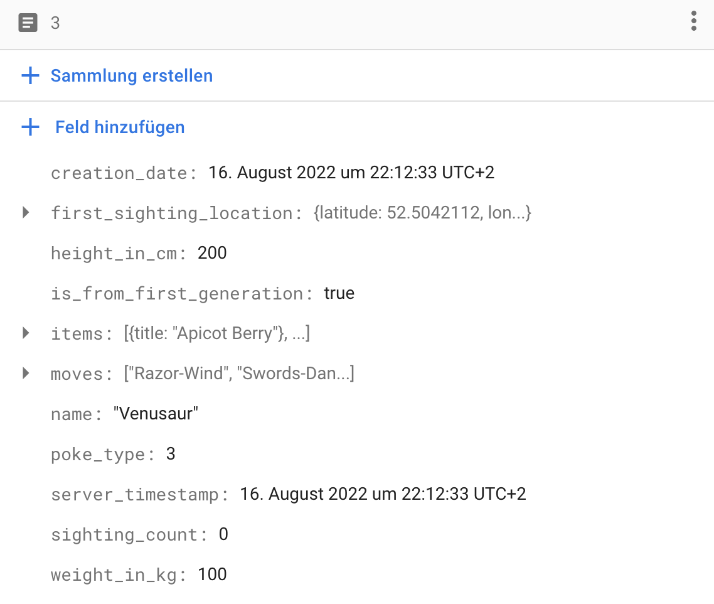

# Firestore

Cloud Firestore is a flexible, scalable database for mobile, web, and server development from Firebase and Google Cloud. Like Firebase Realtime Database, it keeps your data in sync across client apps through realtime listeners and offers offline support for mobile and web so you can build responsive apps that work regardless of network latency or Internet connectivity. Cloud Firestore also offers seamless integration with other Firebase and Google Cloud products, including Cloud Functions.

## Installation
### Nuget
[](https://www.nuget.org/packages/Plugin.Firebase.Firestore/)

> Install-Package Plugin.Firebase.Firestore

## Setup

- Follow the instructions for the [basic setup](https://github.com/TobiasBuchholz/Plugin.Firebase/blob/master/README.md#basic-setup)
- Enable Cloud Firestore at your project in the [Firebase Console](https://console.firebase.google.com/)

## Usage

To be able to fetch your data from Firestore, create a POCO that implements the `IFirestoreObject` interface and has a public parameterless constructor. Use the `FirestoreDocumentId` and `FirestoreProperty` attributes to hook up its properties. For example:

> Firestore's reflection-based model mapping is not currently compatible with full trimming or Native AOT.
> For the other iOS Native AOT requirements, see [iOS NativeAOT (`PublishAot`)](https://github.com/TobiasBuchholz/Plugin.Firebase/blob/development/README.md#ios-nativeaot-publishaot) in the README.

```c#

public sealed class Pokemon : IFirestoreObject
{
    [FirestoreDocumentId]
    public string Id { get; private set; }

    [FirestoreProperty("name")]
    public string Name { get; private set; }

    [FirestoreProperty("weight_in_kg")]
    public double WeightInKg { get; private set; }

    [FirestoreProperty("height_in_cm")]
    public float HeightInCm { get; private set; }

    [FirestoreProperty("sighting_count")]
    public long SightingCount { get; private set; }

    [FirestoreProperty("is_from_first_generation")]
    public bool IsFromFirstGeneration { get; private set; }

    [FirestoreProperty("poke_type")]
    public PokeType PokeType { get; private set; }

    [FirestoreProperty("moves")]
    public IList<string> Moves { get; private set; }
    
    [FirestoreProperty("first_sighting_location")]
    public SightingLocation FirstSightingLocation { get; private set; }

    [FirestoreProperty("items")]
    public IList<SimpleItem> Items { get; private set; }

    [FirestoreProperty("creation_date")]
    public DateTimeOffset CreationDate { get; private set; }

    [FirestoreServerTimestamp("server_timestamp")]
    public DateTimeOffset ServerTimestamp { get; private set; }

    [FirestoreProperty("original_reference")]
    public IDocumentReference OriginalReference { get; private set; }

}
```

This class is represented in firestore like this:



A stored array can contain `null` entries. Reading it into a list property keeps them as `null` when the element type is a reference type such as `string` or `object`, or a nullable value type such as `int?`. A list of a non-nullable value type such as `IList<int>` can't hold `null`, so reading an array with a `null` entry into it throws an `ArgumentNullException` when you read `snapshot.Data`. Both platforms behave the same way.

Documents can also be read as raw dictionaries when the field set is not known at compile time:
```c#
var snapshot = await CrossFirebaseFirestore.Current
    .GetDocument("pokemons/1")
    .GetDocumentSnapshotAsync<Dictionary<string, object>>();

var data = snapshot.Data;
var name = data["name"] as string;
```

A snapshot converts its data the first time `Data` is read. For a class model, later reads of the same snapshot return that same instance, so changes you make to it stay visible through the snapshot, but they are not written to Firestore. A failed conversion isn't kept, so the next read of `Data` tries again. Query snapshots likewise return the same document snapshots each time you enumerate `Documents`, `DocumentChanges` or `GetDocumentChanges(...)`. Each of those lists has its own snapshots, so a change made through `Data` in one list isn't visible in another.

### Error handling

Every failure that the native Firestore SDK reports as a `com.google.firebase.FirebaseException` (Android, which
includes `FirebaseFirestoreException`) or an `NSError` (iOS) is surfaced as `CrossPlatformFirebaseFirestoreException` (`Plugin.Firebase.Core.Exceptions`). That covers the tasks
returned by `IFirebaseFirestore`, `IDocumentReference`, `ICollectionReference`, `IQuery` and `IWriteBatch`, the
exception thrown by `ITransaction.GetDocument`, and the error passed to the `onError` callback of
`AddSnapshotListener`. The type derives from `CrossPlatformFirebaseException`, the base that
`CrossPlatformFirebaseAuthException` shares, and from `FirebaseException`. It keeps the native exception as
`InnerException` and passes the native metadata through:

| Property | Android | iOS |
| --- | --- | --- |
| `NativeExceptionTypeName` | Java canonical class name, e.g. `com.google.firebase.firestore.FirebaseFirestoreException` | `NSError` |
| `NativeErrorCode` | `FirebaseFirestoreException.Code` name, e.g. `INVALID_ARGUMENT`; `null` for other Firebase exceptions | `FirestoreErrorCode` name, e.g. `InvalidArgument`; for other domains or unnamed codes, the number formatted with the invariant culture |
| `NativeErrorDomain` | `null` | `NSError` domain, e.g. `FIRFirestoreErrorDomain` |
| `NativeErrorMessage` | The exception message | The `NSError` localized description |

Only native Firebase failures are wrapped. Argument validation by the native SDKs (for example
`Java.Lang.IllegalArgumentException` on Android, or an Objective-C exception on iOS) and managed exceptions, such
as data conversion errors, propagate unchanged.

```c#
try {
    await CrossFirebaseFirestore.Current.GetDocument("pokemons/1").UpdateDataAsync(("name", "Bulbasaur"));
} catch(CrossPlatformFirebaseFirestoreException e) {
    Console.WriteLine($"{e.NativeErrorDomain} {e.NativeErrorCode}: {e.NativeErrorMessage}");
}
```

Transactions follow the same rules, with one addition. If the update function passed to `RunTransactionAsync`
throws, the transaction is aborted without committing and `RunTransactionAsync` throws a `FirebaseException` whose
`InnerException` is the original exception, on both platforms. A `CrossPlatformFirebaseFirestoreException` that the
plugin raised for a native Firestore error, for example from a failed `ITransaction.GetDocument`, is instead handed
back to the native SDK when the update function lets it propagate. Its `InnerException` is the native
`FirebaseFirestoreException` on Android, or the `NSErrorException` for a `FIRFirestoreErrorDomain` error on iOS. The
native SDK applies its transaction retry rules to that error on both platforms. If the error is retryable, such as
`ABORTED` because a document changed between two reads, the transaction is retried and the update function runs
again. Otherwise, or once no retries are left, `RunTransactionAsync` throws a
`CrossPlatformFirebaseFirestoreException` for the same native error; it isn't wrapped again. On Android the same
applies to a native `FirebaseFirestoreException` that the update function throws directly.

Only the exception that the update function throws is checked. If you catch a failed read and throw your own
exception, even one that keeps the Firestore exception as `InnerException`, the transaction is aborted without a retry
and `RunTransactionAsync` throws a `FirebaseException` whose `InnerException` is your exception. A
`CrossPlatformFirebaseFirestoreException` that doesn't carry a native Firestore error, for example one you construct
yourself, also aborts the transaction without a retry, and `RunTransactionAsync` throws it unchanged.

Firestore stores dates as instants. A `DateTimeOffset` always identifies one. A `DateTime` must have `DateTimeKind.Utc` or `DateTimeKind.Local` and is stored as its UTC instant; writing one with `DateTimeKind.Unspecified`, such as `default(DateTime)`, throws `ArgumentException`. Use `DateTime.SpecifyKind` to say which time zone such a value is in. Dates are read back in UTC.

### Further information

Take a look at the [documentation](https://github.com/AdamEssenmacher/GoogleApisForiOSComponents/blob/master/docs/Firebase/CloudFirestore/GettingStarted.md) for the AdamE.Firebase.iOS.CloudFirestore packages, because Plugin.Firebase's code is abstracted but still very similar.

Since code should be documenting itself you can also take a look at the following classes:
- [src/.../IFirebaseFirestore.cs](https://github.com/TobiasBuchholz/Plugin.Firebase/blob/master/src/Shared/Firestore/IFirebaseFirestore.cs)
- [src/.../ICollectionReference.cs](https://github.com/TobiasBuchholz/Plugin.Firebase/blob/master/src/Shared/Firestore/ICollectionReference.cs)
- [src/.../IDocumentReference.cs](https://github.com/TobiasBuchholz/Plugin.Firebase/blob/master/src/Shared/Firestore/IDocumentReference.cs)
- [src/.../IQuery.cs](https://github.com/TobiasBuchholz/Plugin.Firebase/blob/master/src/Shared/Firestore/IQuery.cs)
- [src/.../ITransaction.cs](https://github.com/TobiasBuchholz/Plugin.Firebase/blob/master/src/Shared/Firestore/ITransaction.cs)
- [src/.../IWriteBatch.cs](https://github.com/TobiasBuchholz/Plugin.Firebase/blob/master/src/Shared/Firestore/IWriteBatch.cs)
- [tests/.../FirestoreFixture.cs](https://github.com/TobiasBuchholz/Plugin.Firebase/blob/master/tests/Plugin.Firebase.IntegrationTests/Firestore/FirestoreFixture.cs)

## Next-release migration notes

On Android, `DateTime` and `DateTimeOffset` values now convert directly to and from the native Firestore `Timestamp` instead of going through `java.util.Date`, so they keep the microseconds that Firestore stores. The native SDKs drop anything smaller than a microsecond. These notes cover Android only; iOS precision is addressed separately.

- Writes keep microseconds. Previously Android truncated written dates to milliseconds.
- Reads keep microseconds, including `FieldValue.ServerTimestamp()` values and values written from iOS or a backend. Previously Android truncated them to milliseconds, so a value read back was earlier than the stored one.
- Query filter values and cursor values (`StartingAt`, `StartingAfter`, `EndingAt`, `EndingBefore`) are no longer truncated to milliseconds. A value read from a document now matches that document in `WhereEqualsTo`, and `StartingAfter` with the last value of a page no longer returns that document again. Equality filters against data that older Android builds wrote truncated to milliseconds can stop matching when the filter value has a sub-millisecond part; truncate the filter value to milliseconds while such data remains.
- `RunTransactionAsync<DateTime>` returns the `DateTime` on Android instead of throwing `InvalidCastException`, and date results of a transaction keep their full precision. On iOS a `DateTime` result still throws `InvalidCastException`; return a `DateTimeOffset` instead.

`null` entries in a stored array now read into typed list properties the same way on both platforms (see [Usage](#usage)). Compared with Plugin.Firebase.Firestore 4.0.0:

- On Android, a list of `string` keeps the `null` entry. Previously it became an empty string. A list of `int`, `long`, `float`, `double`, `decimal` or `bool` throws `ArgumentNullException` when you read `snapshot.Data`. Previously the entry became `0` or `false`.
- On iOS, `null` entries were dropped, so the list was shorter than the stored array and later entries moved to lower indexes: `["a", null, "b"]` read into an `IList<string>` gave two entries. They're now kept, so that list has three entries. A list of a non-nullable value type such as `IList<int>` throws `ArgumentNullException` when you read `snapshot.Data`. Previously `[1, null, 3]` gave `[1, 3]`.
- If a stored array can contain `null`, use a nullable element type such as `IList<int?>` for a list of a value type.

### Firestore exception migration

Firestore methods and snapshot listeners expose native Firebase failures as `CrossPlatformFirebaseFirestoreException` on both platforms. See [Error handling](#error-handling) for the exception and its native metadata.

- Update catches for native exceptions such as `Firebase.Firestore.FirebaseFirestoreException` or `Firebase.FirebaseException` on Android and `Foundation.NSErrorException` on iOS. Catch `CrossPlatformFirebaseFirestoreException` and read `InnerException` if you need the original native exception. Existing catches for `Plugin.Firebase.Core.Exceptions.FirebaseException` still match, including for the iOS methods `GetDocumentSnapshotAsync`, `GetDocumentsAsync`, and `AddDocumentAsync`, which previously reported only the localized description.
- `ITransaction.GetDocument` throws `CrossPlatformFirebaseFirestoreException` instead of `FirebaseFirestoreException` (Android) or a `FirebaseException` without the native error (iOS).
- `RunTransactionAsync` throws `CrossPlatformFirebaseFirestoreException` when the native SDK fails the transaction, for example when the backend rejects the commit, or when the update function lets a failed `ITransaction.GetDocument` propagate. Previously this was `FirebaseFirestoreException` on Android, and `NSErrorException` or a `FirebaseException` wrapping the read failure on iOS.
- On Android, `RunTransactionAsync` throws `FirebaseException` with the original exception as `InnerException` when the update function throws, as on iOS. Previously it threw the native task's `Java.Lang.RuntimeException`.
- The `onError` callback of `AddSnapshotListener` receives `CrossPlatformFirebaseFirestoreException`. Previously it received a `FirebaseException` built from the localized description on iOS, a `FirebaseException` with the native exception as `InnerException` for Android document listeners, and the native `Firebase.FirebaseException` for Android query listeners.
- Some methods now report an exception that the native SDK throws synchronously through the returned `Task`, instead of throwing it before the `Task` is returned. Examples are an `IllegalStateException` on Android after `TerminateAsync`, or an Objective-C exception on iOS. This applies to `IWriteBatch.CommitAsync`, `WaitForPendingWritesAsync`, `DisableNetworkAsync`, `EnableNetworkAsync`, `ClearPersistenceAsync` and `TerminateAsync` on both platforms, and to `IDocumentReference.SetDataAsync`, `UpdateDataAsync` and `DeleteDocumentAsync` on iOS. These exceptions aren't native Firebase failures, so their type doesn't change. Code that awaits the `Task` sees no difference; code that expected the exception before the `Task` was returned has to await it.

On iOS, `RunTransactionAsync` now also retries the transaction after a retryable Firestore error raised inside the update function, when the update function lets it propagate. An example is `ABORTED` from an `ITransaction.GetDocument` that finds the document changed since an earlier read in the same transaction. iOS already re-ran the update function after a retryable commit failure, such as contention with another write; now the native SDK's retry rules decide for errors raised inside the update function too, as they already do on Android. Previously iOS never retried the transaction after such an error. Make sure the update function doesn't change state outside the transaction.

Writing a `DateTime` whose `Kind` is `DateTimeKind.Unspecified` now throws `ArgumentException` on both platforms. Such a value could be UTC or local time, and the platforms disagreed: Android stored it as local time and iOS stored it as UTC, so the same value became a different instant on each platform unless the device ran in UTC. `Utc` and `Local` values are still stored as their UTC instant, and `DateTimeOffset` values are unaffected.

- The check applies wherever Firestore converts a value: `SetDataAsync` with or without `SetOptions`, `UpdateDataAsync`, batch and transaction writes, `IFirestoreObject` properties, list elements, `FieldValue.ArrayUnion` and `FieldValue.ArrayRemove` elements, query filter values and cursor values.
- In a transaction, `ITransaction.SetData` and `UpdateData` throw inside the update function, so `RunTransactionAsync` fails as it does for any exception thrown there: nothing is committed, and the `ArgumentException` is the `InnerException` of the exception it throws rather than the exception itself.
- Returning an Unspecified `DateTime` from the update function also fails the transaction for now, because the result is converted to a native value and back. #740 removes that conversion.
- `default(DateTime)` and `DateTime.MinValue` are Unspecified, so a `DateTime` property that was never set now throws. Set it, or make the property `DateTime?` or `DateTimeOffset?` if "not set" should be stored and read back as null.
- Typed reads into `DateTime?`, in models and in typed dictionaries such as `Dictionary<string, DateTime?>`, now return a UTC `DateTime`. Previously they threw, because a `DateTimeOffset` came back.
- Common sources of Unspecified values:
  - `new DateTime(...)` without a kind, and `DateTime.Parse` of a string without an offset.
  - `DateTimeOffset.DateTime`, which drops the offset. Use `DateTimeOffset.UtcDateTime` instead.
  - A model's `DateTime` property whose field is missing or null in the document. It reads as `default(DateTime)`, so writing the model back throws.
  - UI controls: .NET MAUI `DatePicker.Date` can be Unspecified.
- `DateTime` values read from Firestore are `Utc`, so writing them back is unaffected.

Say which time zone the value is in, or use `DateTimeOffset`. `DateTimeKind.Utc` keeps the instant iOS stored before, and `DateTimeKind.Local` keeps the one Android stored:

```c#
var dueDate = DateTime.Parse("2026-01-01T09:00:00"); // Kind is Unspecified

// Before: stored as 09:00 UTC on iOS and 09:00 device time on Android. Now: throws ArgumentException.
await document.SetDataAsync(("due", dueDate));

// Either of these works on both platforms.
await document.SetDataAsync(("due", DateTime.SpecifyKind(dueDate, DateTimeKind.Local)));
await document.SetDataAsync(("due", new DateTimeOffset(dueDate, TimeSpan.FromHours(-5))));
```

## Release notes
- Version 3.1.3
  - Added the handling of a FieldValue into a Hashmap correctly + Prevent crashing when a list on the server has a null as an entry (PR #437)
- Version 3.1.2
  - Using AdamE.Firebase.iOS.* minimum version 11
  - Use JavaObject constructor instead of addding individual items
- Version 3.1.1
  - ToNSObject and ToJavaObject handle null inputs (PR #352)
  - Fixing IWriteBatch.UpdateData issue where .NET objects were not being converted to NSObjects (PR #351)
- Version 3.1.0
  - Update to .net8
- Version 3.0.0
  - Swapped Xamarin.Firebase.iOS.Firestore (native SDK 8.10.0) for AdamE.Firebase.iOS.Firestore (native SDK 10.24.0)
- Version 2.0.7
  - Fixed missing DateTime in firestore (PR #280)
  - Fix simple number arrays on firestore android (issue #276)
- Version 2.0.6
  - Support int properties on IFirestoreObjects on Android (PR #247)
  - Firestore plugin converts NSNumbers to nullable .NET types (e.g. float?, int?, long?) (PR #250)
- Version 2.0.5
  - Bumped up Xamarin.Firebase.Firestore package to version 124.8.1.1
- Version 2.0.4
  - Firestore CollectionReference inherits Query (PR #205)
  - Adding GetCollectionGroup to FirebaseFirestore (PR #207)
  - Adding synchronous versions of WriteBatch.Commit() (PR #208)
  - Added the Parent property to CollectionReference. (PR #209)
- Version 2.0.3
  - Use `Debug.WriteLine()` in object extensions (issue #174)
- Version 2.0.2
  - re-add tohashmap extension for firestore setdataasync method when data is a dictionary of objects
  - fix firestore setdataasync for ios
- Version 2.0.1
  - Remove unnecessary UseMaui property from csproj files
  - Readd net6.0 tfm
